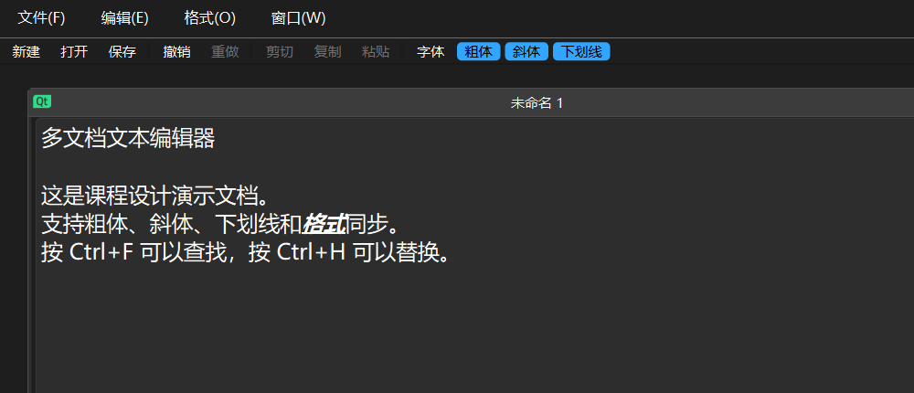

# CSP-classwork

中国矿业大学（CUMT）CSP 课程大作业。

本仓库用于存放课程实验、课程设计及相关实验报告。

## 项目预览

|                      Calculator                       |                       PuzzleGame                       |                          TextEditor                          |
| :---------------------------------------------------: | :----------------------------------------------------: | :----------------------------------------------------------: |
|  |  |  |

## 实验项目

### 1. Calculator —— 基于 Qt 的简易计算器

使用 **C++ / Qt** 实现的简易计算器，支持连续四则运算，并使用双栈算法完成表达式解析与计算。

**项目内容：**

* Qt 图形化界面
* 四则运算
* 连续表达式计算
* 小数计算
* 括号及运算符优先级处理
* 双栈表达式求值
* 基本输入合法性判断

**相关文件：**

* [Calculator 项目源码](./Calculator/)
* [Calculator 实验报告](./Calculator/REPORT.md)

---

### 2. PuzzleGame —— 基于 Qt 的拼图游戏

使用 **C++ / Qt 6** 实现的图形化拼图游戏。玩家可以通过点击两块拼图交换位置，将打乱的图片恢复为正确排列，并支持自定义拼图难度。

**项目内容：**

* Qt 图形化游戏界面
* 拼图图片加载、裁剪与分割
* 点击交换拼图块及完成状态判断
* 随机切换内置图片、选择本地图片
* 查看原图与重新开始游戏
* 自定义拼图行数和列数（2～10）
* 游戏计时、步数统计及最佳成绩记录

ps: 学会用 Visio 画图啦！

**相关文件：**

* [PuzzleGame 项目源码](./PuzzleGame/)
* [PuzzleGame 实验报告](./PuzzleGame/REPORT.md)

---

### 3. TextEditor —— 基于 Qt 的多文档文本编辑器

使用 **C++ / Qt 6 / Qt Widgets** 实现的多文档文本编辑器。主窗口使用 `QMainWindow`，
中央工作区用 `QMdiArea` 管理多个 `Document` 子窗口；每个 `Document` 内部持有一个
独立的 `QTextEdit`，因此多个文档的内容、光标和撤销栈互不影响。

查找替换是本项目的设计重点：`FindReplaceDialog` 以非模态方式显示，通过
`QPointer<QTextEdit>` 安全持有当前编辑区，支持“查找下一个”“替换”“全部替换”
三种操作。

**项目内容：**

* `QMdiArea` 多文档管理，`Document` 独立封装文件路径、`QTextEdit` 与格式设置
* 新建、打开、保存文件，统一使用 UTF-8 纯文本读写
* 撤销 / 重做、剪切 / 复制 / 粘贴
* 字体、粗体、斜体、下划线、左 / 中 / 右对齐
* 非模态查找替换：查找下一个、替换当前、全部替换
* `replaceAll()` 使用 `beginEditBlock()` / `endEditBlock()` 合并为一次撤销，并从
  `found.position()` 继续查找，避免替换文本包含查找词时死循环
* 窗口层叠、水平平铺、垂直平铺
* 使用 Visio 绘制整体运行流程、查找替换流程和程序结构图

**说明：** 当前为简化版，查找暂不支持循环、区分大小写、全字匹配和正则表达式；
文档以 UTF-8 纯文本保存，字体、粗体等字符格式不会写入 `.txt` 文件。

**相关文件：**

* [TextEditor 项目源码](./TextEditor/TextEditor/)
* [TextEditor 实验报告（Markdown）](./TextEditor/TextEditor/REPORT.md)
* [TextEditor 设计图表与截图](./TextEditor/picture/)

---

## 仓库结构

```text
CSP-classwork/
├── Calculator/
│   ├── REPORT.md
│   ├── mainwindow.cpp
│   ├── mainwindow.h
│   ├── mainwindow.ui
│   └── ...
│
├── PuzzleGame/
│   ├── REPORT.md
│   ├── main.cpp
│   ├── mainwindow.cpp
│   ├── mainwindow.h
│   ├── mainwindow.ui
│   ├── resources.qrc
│   └── ...
│
├── TextEditor/
│   ├── TextEditor/              # Qt 源码与实验报告
│   │   ├── REPORT.md
│   │   ├── CMakeLists.txt
│   │   ├── main.cpp
│   │   ├── mainwindow.cpp
│   │   ├── mainwindow.h
│   │   ├── mainwindow.ui
│   │   ├── document.cpp
│   │   ├── document.h
│   │   ├── findreplacedialog.cpp
│   │   └── findreplacedialog.h
│   └── picture/                 # Visio 图、PNG 与界面截图
│
└── README.md
```


## 开发环境

* C++17
* Qt 6.11.2（MinGW 64-bit）
* Qt Creator
* CMake
* STL
* Microsoft Visio（流程图 / 结构图）

## 说明

本仓库仅用于记录 CSP 课程相关的实验代码、实验报告以及课程设计资料。

---

**Author:** [Marlobbz](https://github.com/Marlobbz)
